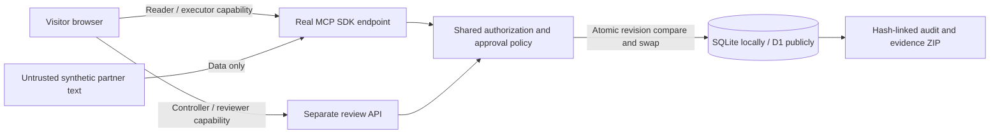

# Architecture and decisions

React/Vite frontend, official MCP client/server SDK 2.4, web-standard Streamable HTTP, a shared TypeScript policy service, Node SQLite locally and Cloudflare Worker/D1 in public hosting. Zod strict input schemas reject unknown fields. A request-scoped SDK server avoids isolate-level visitor state. Browser/workerd package conditions select the SDK's CSP-compatible validator.

## Trust boundaries

Partner error text is untrusted evidence. The runner follows a fixed read/read/draft sequence. A deterministic allowlisted template uses error identifiers and codes, not instructions in raw text. No language model or autonomous planner is involved. This demonstrates enforceable tool boundaries and does not establish resistance of an arbitrary LLM to prompt injection.

Five independently generated opaque bearer capabilities represent reader, executor, controller, reviewer and a wrong-audience diagnostic client. Tokens are workspace-scoped, expire after 24 hours, carry stored server-side subjects/scopes/audiences and are stored as SHA-256 hashes in SQL. No token is forwarded to another service or returned by an MCP tool. The browser retains its keys locally. They are demo capabilities accessible to the same visitor, not separate human identities or a secure enterprise login.

The MCP endpoint uses manual bearer setup. It does not implement an OAuth authorization server, PKCE, federated identity or automatic ChatGPT/Codex app installation. The native hosting MCP capability is deliberately not declared: the public demo exercises a standalone SDK endpoint at `/api/mcp` and does not require ChatGPT sign-in. A production deployment would need an external OAuth 2.1 authorization server, protected-resource discovery, verified identities, managed secrets, rate limiting, revocation and durable operational monitoring.

## Write control

The review API accepts only a revalidated deterministic proposal. Approval binds the immutable payload SHA-256, workspace, demo-agent subject, MCP resource, order version and ten-minute expiry. Only the review capability may decide. The execute tool cannot approve. Execution rechecks all bindings, changes the approval to consumed, appends one task, advances the order version and records the audit in one optimistic SQL update. Replay returns the same task; a changed digest, rejected/pending/expired decision or stale order fails closed. A consumed replay remains a read of its existing task within the workspace lifetime.

The SQL model has two tables: workspaces and token hashes. A bounded workspace document holds typed orders, error events, approvals, tasks and audit records. Compare-and-swap on the SQL revision atomically commits the complete state, including task and audit, in both SQLite and D1. Six bounded retries handle contention; unresolved contention returns 409. A document model keeps this deliberately small demo portable. Normalised tables and queue-backed processing would suit production scale.

## Capacity, evidence and deployment

Workspaces: 24 hours, at most 200 active, at most 20 created per minute globally; expiry cleanup deletes old tokens by SQL cascade. Each workspace allows 300 audit events, 20 proposals and 10 tasks. Request bodies are limited to 16 KiB. These are resource caps, not production anti-abuse controls. Browser origin and server host checks reject unexpected origins/hosts; clients without an Origin header still require bearer capabilities.

The audit is hash-linked and verified alongside proposal/task bindings and source revisions before export. This detects partial changes, not a malicious party rewriting the whole chain; it is not signed independent attestation. Domain-level reads and denials are audited. SDK protocol validation failures are shown by the wire inspector but do not become domain events. No request authorization headers enter traces, downloads or logs.

Assets and documentation are embedded in a single Worker so the same response security headers cover the whole application. D1 is a provisioned Sites binding. Migrations are generated with Drizzle and applied by deployment, never at request time. GitHub Actions validates Windows and Linux.
